<p align="center">
  
</p>

<p align="center">
  <a href="https://richardlemon.com"><b>richardlemon.com</b></a>
  &nbsp;/&nbsp;
  <a href="https://bsky.app/profile/richardlemon.com"><b>@richardlemon.com</b> on Bluesky</a>
  &nbsp;/&nbsp;
  <a href="https://ideebv.nl"><b>Ideebv</b></a>
</p>

<br>

```text
  RICHARD LEMON  -  "WORKING TITLE"                         LP / RL-2015 / STEREO
  =============================================================================

  SIDE A  -  THE DAY JOB                                                     
  -----------------------------------------------------------------------------
  A1   Bedrock & Sage (WordPress, Done Properly) ......................... 4:20
  A2   Tailwind In The Margins ........................................... 3:15
  A3   Next.js After Hours ............................................... 5:02
  A4   Astro (Interlude) ................................................. 1:48
  A5   Pixel-Perfect Or It Didn't Happen ................................. 3:33

  SIDE B  -  WHAT'S NEXT                                                     
  -----------------------------------------------------------------------------
  B1   Generative Engine Optimization .................................... 6:10
  B2   llms.txt (A Letter To The Machines) ............................... 2:47
  B3   Schema.org Says It Better ......................................... 4:04
  B4   Sustainable Pace (Reprise) ........................................ 7:00

  =============================================================================
  Recorded at Wilhelminasingel 111, Maastricht. Mixed in Cursor and VS Code.
  Mastered in Docker. Committed with Tower. No heroics were harmed.
```

<br>

### Liner notes

I build websites for brands that care about the details, as one third of [Ideebv](https://ideebv.nl), a small studio in Maastricht where I have been the developer since 2015. Most of my days are high-end WordPress on Bedrock and Sage, with Next.js, Astro and Tailwind whenever a project asks for something leaner.

Lately the question has changed. Search is no longer just ten blue links, so a growing part of my work is making sites legible to the models that now answer people's questions: `llms.txt`, clean Schema.org graphs, and content that says what it means. Some call it GEO. I call it doing SEO honestly for a new kind of reader.

Before any of this I was digging through crates for breaks, and that habit never left. Good code is a lot like a good sample: find the right piece, cut it clean, and make it sit in the pocket.

<br>

### The rig

<p>
  
  
  
  
  
  
  
  
  
</p>

<br>

### B-sides

<table>
  <tr>
    <td width="33%" valign="top">
      <b>Dugout</b><br>
      <sub>Coaching the U12s at HSCM baseball. Best code review I get all week comes from eleven-year-olds.</sub>
    </td>
    <td width="33%" valign="top">
      <b>Crates</b><br>
      <sub>Breakbeats, graffiti and b-boy culture shaped how I look at everything, including a grid.</sub>
    </td>
    <td width="33%" valign="top">
      <b>Camera roll</b><br>
      <sub>Shooting with an iPhone, because the best camera is still the one in your pocket.</sub>
    </td>
  </tr>
</table>

<br>

<p align="center">
  <sub><code>// drop the needle anywhere. it's all one record.</code></sub>
</p>
